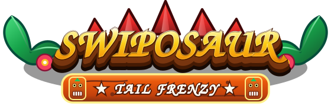
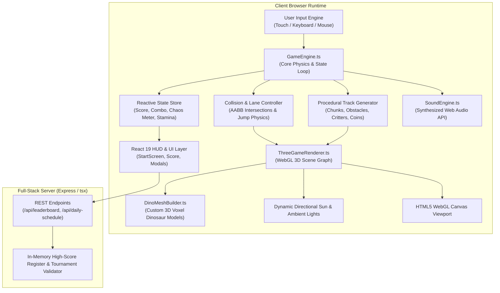
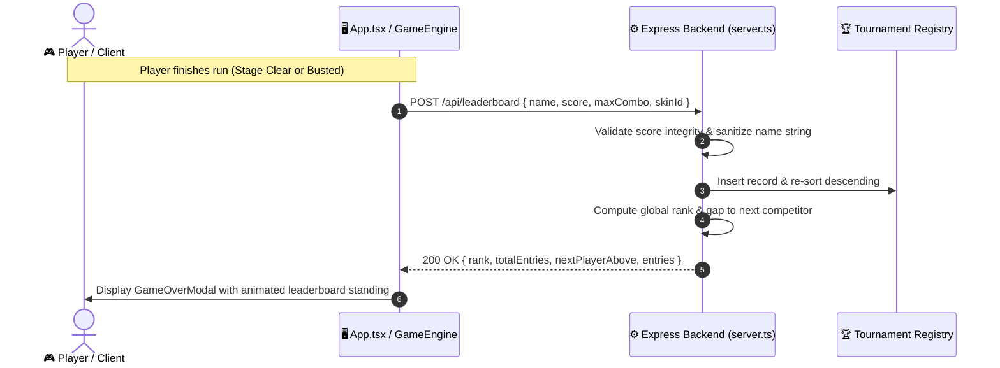

<p align="center">
  
</p>

<p align="center">
  <strong>Fast, hilarious 3D dinosaur runner where you swipe, tail-whip prehistoric critters, charge the Primal Roar, and outrun the enraged stampede!</strong>
</p>

<p align="center">
  <a href="#-license"></a>
  <a href="https://threejs.org/"></a>
  <a href="https://react.dev/"></a>
  <a href="https://www.typescriptlang.org/"></a>
  <a href="https://tailwindcss.com/"></a>
  
  
  
</p>

---

## 📖 Table of Contents

- [🦖 Lore & Cinematic Premise](#-lore--cinematic-premise)
- [✨ Key Features](#-key-features)
- [🕹️ Controls & Input System](#️-controls--input-system)
- [🦕 Dinosaur Roster & Species Matrix](#-dinosaur-roster--species-matrix)
- [🌋 Biomes, Hazards & Power-Ups](#-biomes-hazards--power-ups)
- [📊 Advanced System Architecture & Engine Diagrams](#-advanced-system-architecture--engine-diagrams)
  - [1. Game Engine & Render Loop Architecture](#1-game-engine--render-loop-architecture)
  - [2. Frame Execution & Collision Pipeline](#2-frame-execution--collision-pipeline)
  - [3. Full-Stack Tournament & Leaderboard Flow](#3-full-stack-tournament--leaderboard-flow)
- [🔊 Sound Synthesizer System](#-sound-synthesizer-system)
- [📸 1080x1350 Verified Share Cards](#-1080x1350-verified-share-cards)
- [🛠️ Tech Stack & Dependencies](#️-tech-stack--dependencies)
- [🚀 Local Development & Deployment](#-local-development--deployment)
- [📁 Project Tree](#-project-tree)
- [📜 License](#-license)

---

## 🦖 Lore & Cinematic Premise

In a vibrant prehistoric world untouched by the great extinction, the tropical valleys and ancient volcanic ruins are governed by one universal rule: **the dinosaur with the swiftest tail rules the roost!**

You are **Swiposaur**, an agile, sun-loving dinosaur sporting party sunglasses and an unstoppable tail whip. While casually scavenging golden eggs, ancient fruit, and dino coins across the lively prehistoric bazaar, you’ve accidentally stepped on the toes of the grumpy tribal critters. Now, the entire valley has launched an all-out stampede on your tail!

Dash across shifting lanes, tail-whip pesky raptors and market vendors, leap over burning magma boulders, slide underneath fallen giant ferns, and build up your **Primal Chaos Meter** to roar into unstoppable fever speed!

---

## ✨ Key Features

- **⚡ Real-Time 3D Voxel Engine**: Custom-built on Three.js featuring dynamic shadows, voxel mesh construction, directional sun lighting, volumetric biome fog, and camera shake physics.
- **🦖 6 Playable Dinosaur Champions**: Fully animated voxel models with custom dorsal crests, fangs, hats, and species passives (T-Rex, Spinosaurus, Golden Raptor, Emerald Swiposaur, Cyber Rex, Midnight Rex).
- **🌴 4 Handcrafted Biomes**:
  - *Prehistoric Jungle*: Vibrant flora, twisting roots, and ancient stone bridges.
  - *Volcano Basin*: Scorched basalt, rivers of boiling magma, and raining embers.
  - *Neon Dino-City*: Futuristic retro-cyber streetscape with high-tech barriers.
  - *Desert Canyons*: Arid sandstone trenches, dusty winds, and tumbleweed hazards.
- **💥 Deep Arcade Mechanics**:
  - *Tail Whip & Critter Slaps*: Whack obstacles and enemies to gain instant combo multipliers.
  - *Primal Roar / Chaos Meter*: Hit consecutive slaps to enter **Frenzy Mode** (invincible sprint, boosted points, screen-blurring speed).
  - *Stampede Distance / Busted Meter*: Stumbling allows the mob behind you to catch up; keep sprint rhythm to evade arrest.
- **🏆 Live Full-Stack Tournament Leaderboard**:
  - Real-time Node/Express server tracking high-scores, maximum combos, and player ranks.
  - Weekly UTC tournament reset schedules with automated rank gap calculations.
  - Privacy-friendly gameplay telemetry.
- **🎁 Daily Progression**:
  - 7-day UTC-synchronized daily login rewards streak with escalating coin rewards.
  - Rotating daily missions with claimable coin bounties.
- **📱 PWA & Offline Readiness**: One-click home-screen install prompt, full-screen standalone mode, and responsive touch controls.

---

## 🕹️ Controls & Input System

### Desktop / Keyboard
| Key | Action | In-Game Mechanics |
| --- | --- | --- |
| `A` / `D` or `←` / `→` | **Steer Lane** | Smooth isometric lane transition (Left / Center / Right) |
| `W` or `↑` | **Jump** | Vault over small rocks, barricades, and low critters |
| `S` or `↓` | **Slide** | Duck under high tree trunks, hazard arches, and signposts |
| `Space` / `F` / `Enter` | **Tail Whip / Slap** | Sweep tail to slap nearby pedestrians & obstacles for combo points |
| `P` / `Esc` | **Pause** | Freeze game state and bring up pause menu |

### Mobile / Touch Gestures
- **Swipe Left / Right**: Instant lane dodge
- **Swipe Up**: High jump
- **Swipe Down**: Low duck & slide
- **Tap Screen / Tail Button**: Heavy tail strike
- **Virtual Gamepad**: Toggleable retro on-screen D-pad and buttons in Settings

---

## 🦕 Dinosaur Roster & Species Matrix

| Dinosaur | Species Class | Colorway | Signature Ability | Speed Bonus | Unlock Cost |
| :--- | :--- | :--- | :--- | :---: | :---: |
| **Rexy Prime** | Tyrannosaur | Crimson / Ruby | Heavy Footstep, Baseline Endurance | `+0%` | *Default* |
| **Bubbles Surf** | Spinosaurus | Ocean Cyan / Coral | Aquatic Agile Lane Shift | `+10%` | 200 🪙 |
| **Goldie Bash** | Raptor | 24K Gold / Topaz | Golden Magnetism, Coin Multiplier | `+15%` | 350 🪙 |
| **Emerald Swiposaur** | Stegosaur / Rex Hybrid | Jungle Green / Mint | Devastating Tail Smash Radius | `+20%` | 500 🪙 |
| **Cyber Rex** | Mecha-Saur | Neon Purple / Cyan | High-Torque Boost & Cyber Glitch Shield | `+25%` | 800 🪙 |
| **Midnight Rex** | Shadow Predator | Obsidian / Violet | Silent Prowl, Extended Chaos Frenzy | `+30%` | 1200 🪙 |

---

## 🌋 Biomes, Hazards & Power-Ups

### World Biomes
```
  [Prehistoric Jungle] ──► [Volcano Basin] ──► [Neon Dino-City] ──► [Desert Canyons]
  • Dense Palm Trees        • Basalt Pillars     • Hologram Pillars   • Sand Dunes
  • Bamboo Roadblocks       • Lava Fissures      • Neon Barriers      • Cacti Barricades
  • Jungle Pedestrians      • Fire Critters      • Drone Obstacles    • Bandit Critters
```

### Power-Ups & Collectibles
- 🪙 **Dino Coins**: Universal currency for unlocking character skins and map stages.
- ⚡ **Energy Spark**: Fills 35% of the Chaos Meter instantly.
- 🧲 **Fossil Magnet**: Automatically draws all nearby coins and tokens toward your dino.
- 🛡️ **Pangolin Shield**: Absorbs one obstacle impact without slowing your pace.
- 🌶️ **Primal Pepper**: Triggers immediate Frenzy Mode overdrive for 8 seconds.

---

## 📊 Advanced System Architecture & Engine Diagrams

### 1. Game Engine & Render Loop Architecture



### 2. Frame Execution & Collision Pipeline

```
  ┌────────────────────────────────────────────────────────────────────────┐
  │                        60 FPS GAME ENGINE TICK                         │
  └──────────────────────────────────┬─────────────────────────────────────┘
                                     │
           ┌─────────────────────────┴─────────────────────────┐
           ▼                                                   ▼
   [Gather Input Buffer]                               [Update Delta Time]
   • Lane Steer (-1, 0, +1)                             • Standardized dt clamp
   • Jump / Slide impulses                             • Game speed multiplier
           │                                                   │
           └─────────────────────────┬─────────────────────────┘
                                     │
                                     ▼
                      [Update Player Physics & Pose]
                      • Y-Axis Gravity & Jump Velocity
                      • Lane Interpolation (Lerp X-Pos)
                      • Tail Whip Sweep Arc (Radius check)
                                     │
                                     ▼
                      [Update Track World Elements]
                      • Spawn incoming road segments
                      • Recycle despawned world chunks
                      • Update pedestrian critter animations
                                     │
                                     ▼
                       [AABB Collision Detection]
               ┌─────────────────────┼─────────────────────┐
               ▼                     ▼                     ▼
       [Critter Hit]          [Obstacle Crash]      [Coin Picked Up]
       • Check Tail Range     • Not Sliding/Jumping • +Score Value
       • Whack! +Combo        • Busted Meter +35%   • +Coin Count
       • Sound: playSlap()    • Sound: playCrash()  • Sound: playCoin()
               │                     │                     │
               └─────────────────────┼─────────────────────┘
                                     │
                                     ▼
                        [Render Three.js 3D Scene]
                        • Move Camera (Isometric Tilt)
                        • Update Dynamic Shadows & Fog
                        • Render WebGL Frame Buffer
```

### 3. Full-Stack Tournament & Leaderboard Flow



---

## 🔊 Sound Synthesizer System

Swiposaur features a **100% code-synthesized audio engine** built on the browser’s native **Web Audio API**. There are zero external audio files to download, resulting in lightning-fast load times and authentic arcade chip-sound dynamics:

- **Slap / Tail Strike**: Modulated bandpass sweep with noise burst.
- **Jump**: Ascending pitch triangle oscillator (`180Hz ➔ 420Hz`).
- **Slide**: Low-pass whoosh filtered sweep.
- **Coin Collect**: Twin high-pitch sine arpeggio (`987Hz ➔ 1318Hz`).
- **Frenzy Overdrive**: Resonant pulse wave chord progression with stereo vibrato.
- **Crash / Game Over**: Decaying white noise explosion with sub-bass rumble.

---

## 📸 1080x1350 Verified Share Cards

Swiposaur includes an in-engine **Verified 8-Bit Arcade Scorecard Generator** (`shareCard.ts`). At the end of any run, players can generate a pixel-crisp, high-definition (1080×1350) official run certificate:

- **Official Arcade Ribbon Header**: `★ OFFICIAL ARCADE RECORD ★`
- **Large Format Score Display**: Monospace retro score formatting
- **Stats Grid**: Slap count, maximum combo streak, distance traveled, and frenzy activations
- **Player Signature & Verification Timestamp**: Authenticated date stamp
- **One-Click Download**: Direct canvas-to-blob PNG export ready for Instagram, X, Discord, or TikTok

---

## 🛠️ Tech Stack & Dependencies

### Core Frameworks
| Dependency | Version | Purpose |
| :--- | :--- | :--- |
| **React** | `^19.0.1` | Declarative UI, modals, HUD, and screen routing |
| **Three.js** | `^0.186.1` | 3D WebGL renderer, voxel geometry, camera controller |
| **TypeScript** | `^7.0.2` | Type safety across physics, entities, and server schemas |
| **Express** | `^4.21.2` | Full-stack REST API server and tournament leaderboard |
| **Tailwind CSS** | `^4.3.3` | Modern utility styling for claymorphic arcade UI |
| **Vite** | `^8.3.0` | Ultra-fast development bundling and production build pipeline |
| **tsx** | `^4.21.0` | Node.js TypeScript execution for the full-stack server |
| **Lucide React** | `^0.546.0` | Crisp UI icons |

---

## 🚀 Local Development & Deployment

### 1. Requirements
- **Node.js**: v18.0.0 or higher
- **npm** or **bun**

### 2. Installation & Running

```bash
# 1. Clone repository
git clone https://github.com/thesithunyein/1122.git swiposaur
cd swiposaur

# 2. Install dependencies
npm install

# 3. Start development server (serves Vite & API on http://localhost:3000)
npm run dev
```

### 3. Production Build

```bash
# Build production client bundle
npm run build

# Start production server
npm start
```

---

## 📁 Project Tree

```
swiposaur/
├── api/
│   └── leaderboard.ts              # Serverless leaderboard endpoint
├── public/
│   ├── swiposaur-logo.svg          # 3D Vector brand logo (Lilita One, extruded)
│   ├── partysaur-logo.svg          # Vector asset alias
│   ├── apple-touch-icon.png        # High-res 512x512 PWA icon
│   └── assets/                     # Graphic resources and document guides
├── server.ts                       # Express backend server with Vite dev middleware
├── src/
│   ├── components/                 # React UI components
│   │   ├── SwiposaurLogo.tsx       # 3D Interactive tilted logo
│   │   ├── StartScreen.tsx         # Main arcade menu & difficulty selector
│   │   ├── HUD.tsx                 # Score, combo multiplier & stamina display
│   │   ├── GameOverModal.tsx       # Run summary, rank badges, share card modal
│   │   ├── LeaderboardModal.tsx    # Live tournament standings dialog
│   │   ├── SkinsModal.tsx          # Dinosaur character shop
│   │   ├── LevelSelectModal.tsx    # Campaign level map selector
│   │   ├── MapSelectModal.tsx      # World biome selector
│   │   ├── DailyRewardsModal.tsx   # UTC 7-day streak claim modal
│   │   ├── DailyMissionsModal.tsx  # Daily mission objectives modal
│   │   ├── AchievementsModal.tsx   # Trophies & milestone badges
│   │   ├── TouchControls.tsx       # On-screen swipe pads & buttons
│   │   ├── PWAInstallModal.tsx     # Home-screen install prompt
│   │   └── SettingsModal.tsx       # Audio toggles and graphic settings
│   ├── game/                       # Core engine & mechanics
│   │   ├── GameEngine.ts           # Game loop, collision logic, spawning
│   │   ├── ThreeGameRenderer.ts    # Three.js WebGL scene & lighting pipeline
│   │   ├── DinoMeshBuilder.ts      # Voxel mesh builders for all species
│   │   ├── SoundEngine.ts          # Pure Web Audio synthesizer
│   │   ├── shareCard.ts            # High-res 1080x1350 canvas certificate generator
│   │   ├── levels.ts               # Campaign progression definitions
│   │   ├── maps.ts                 # Biome parameters and obstacle tables
│   │   ├── constants.ts            # Skins, speeds, and default leaderboards
│   │   └── types.ts                # TypeScript game types and interfaces
│   ├── App.tsx                     # Main game container and state coordinator
│   ├── main.tsx                    # React DOM entry point
│   └── index.css                   # Tailwind CSS & global arcade rules
├── index.html                      # HTML5 entry point with game metadata
├── metadata.json                   # Applet configuration & metadata
├── package.json                    # Dependencies & full-stack scripts
├── tsconfig.json                   # TypeScript configuration
└── vite.config.ts                  # Vite build setup
```

---

## 📜 License

```
Copyright 2026 Swiposaur Contributors

Licensed under the Apache License, Version 2.0 (the "License");
you may not use this file except in compliance with the License.
You may obtain a copy of the License at

    http://www.apache.org/licenses/LICENSE-2.0

Unless required by applicable law or agreed to in writing, software
distributed under the License is distributed on an "AS IS" BASIS,
WITHOUT WARRANTIES OR CONDITIONS OF ANY KIND, either express or implied.
See the License for the specific language governing permissions and
limitations under the License.
```

---

<p align="center">
  Built with ❤️ for arcade game lovers. Have fun dodging, tail-whipping, and climbing the Swiposaur leaderboards! 🦖🏆
</p>
