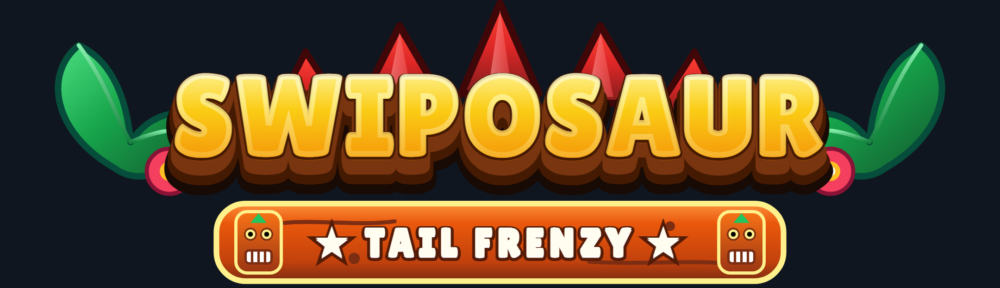
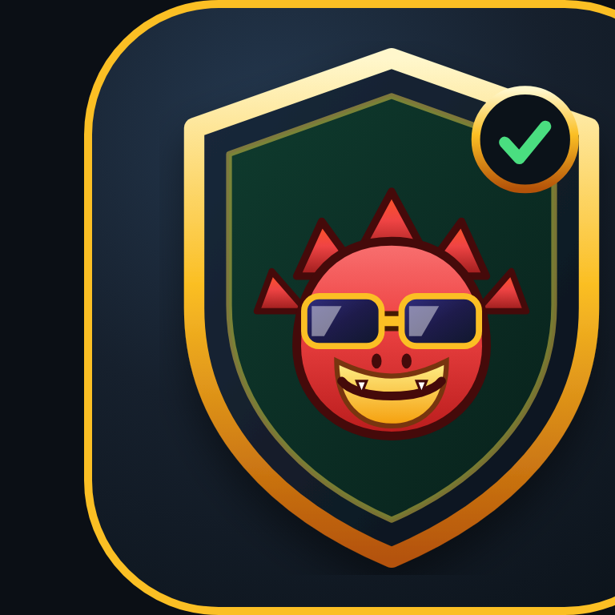
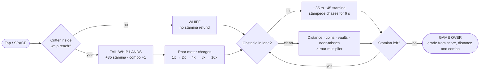
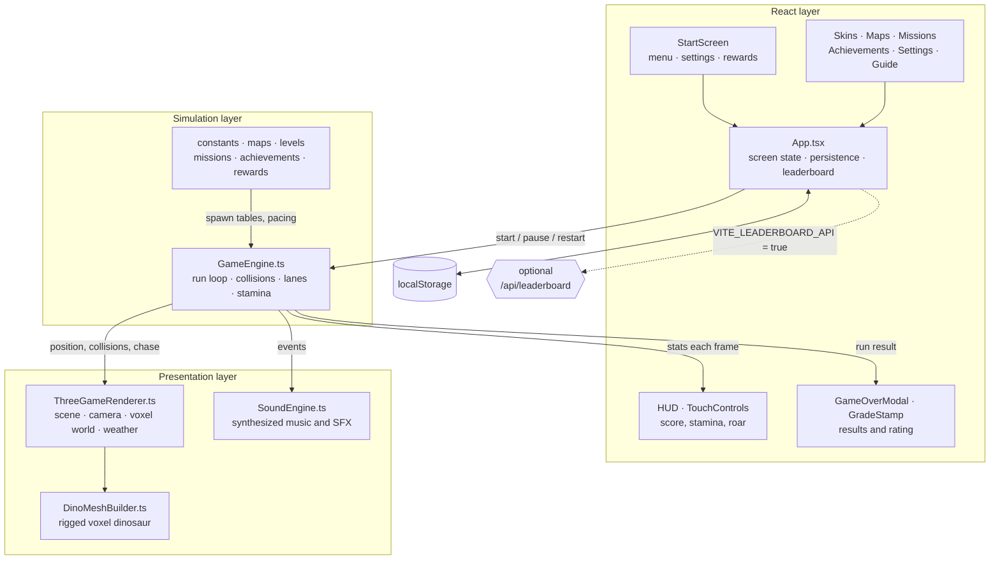

<div align="center">



<br />



### A 3D voxel dinosaur runner for the browser

Swipe between three lanes, tail-whip prehistoric critters to refill stamina,
charge the Primal Roar and outrun the stampede.

[](https://swiposaur.vercel.app/)

[](https://react.dev)
[](https://threejs.org)
[](https://vite.dev)
[](https://www.typescriptlang.org)
[](LICENSE)

**Digit7 Jam 2026 · HTML arcade game · built by [Sithu Nyein](https://github.com/thesithunyein)**

</div>

---

## What it is

Swiposaur is a one-thumb endless runner that runs entirely in the browser: no plugins,
no server, no asset downloads. The whole world — dinosaur, critters, biomes, weather and
soundtrack — is generated in code at runtime.

| | |
| --- | --- |
| **Playable build** | `v1.0.0` (tag [`v1.0.0`](../../releases/tag/v1.0.0)) |
| **Live build** | <https://swiposaur.vercel.app/> |
| **Engine** | React 19 + Three.js, custom voxel meshes, synthesized Web Audio |
| **Entry point** | `index.html` → `src/main.tsx` |
| **Footprint** | ~2.4 MB production build, zero image/audio files |

---

## How it works

### The loop



1. **Opening cinematic.** A rival blocks the road; the first tap lands a cinematic
   mega tail-whip and puts the camera behind the dino.
2. **Safe start (6 s).** The road is clear, the mob is off-camera and a mistake cannot
   end the run — the first obstacle is never a blind death.
3. **Three-hit stamina.** A stumble costs 35–45 stamina. From full health that is three
   mistakes; each hit also spawns the chasing stampede for 6 seconds unless you run clean.
4. **Whip to survive.** A landed whip refunds +35 stamina and charges the roar meter.
   Miss everything and stamina drains until the run ends.
5. **Roar multiplier.** The meter steps `1x → 2x → 4x → 8x → 16x`; every point of score
   rides on it, so chaining whips is worth more than surviving passively.

### Scoring and grades

Score is `distance + coins + vaults + near-misses`, multiplied by the current roar tier.
The grade stamp on the game-over card is derived from that run, not from the multiplier
alone:

| Grade | Title | Threshold |
| :---: | --- | --- |
| **S+** | Apex Primal Legend | 24,000 pts — or 1,100 m with a 12× combo |
| **S** | Master Dino Drifter | 14,000 pts — or 800 m with an 8× combo |
| **A** | Speedway Champion | 7,000 pts |
| **B** | Rising Roarer | 3,000 pts |
| **C** | Stampede Rookie | anything below |

### Systems map



A single `requestAnimationFrame` loop owns the simulation: `GameEngine` advances the
world with a fixed timestep, resolves lane changes, jumps and whip hitboxes, then hands
camera and entity transforms to `ThreeGameRenderer`, which draws them with instanced
voxel meshes on a single scene graph. React never re-renders per frame — it only receives
throttled stat snapshots, so the DOM stays cheap while the canvas runs at full speed.

---

## Controls

| Action | Desktop | Mobile |
| --- | --- | --- |
| Change lane | `A` / `D`, `←` / `→` | Swipe left / right |
| Jump | `W`, `↑`, or `Space` when not near a critter | Swipe up |
| Slide | `S`, `↓` | Swipe down |
| Tail-whip | `Space`, `F`, `Enter`, or the whip button | Tap the whip button / tap screen |
| Pause | `P` / `Esc` | Pause button |

---

## Quick start

```bash
npm install
npm run dev        # http://localhost:5173
```

Production build (this is the folder to zip for the jam submission):

```bash
npm run build      # outputs ./dist
npm run preview    # serve ./dist locally
```

Type check:

```bash
npm run typecheck
```

The optional Express/leaderboard server is not needed to play. To run the full-stack dev
server (API + Vite middleware) instead:

```bash
npm run dev:api    # http://localhost:3000
```

---

## Configuration

The game is static and works with **no backend**. Two optional Vite environment variables
enable extra online features when a server is available:

| Variable | Default | Purpose |
| --- | --- | --- |
| `VITE_LEADERBOARD_API` | unset (off) | `true` sends scores to `/api/leaderboard` and merges the online board |
| `VITE_ANALYTICS_URL` | unset (off) | POST endpoint for optional gameplay telemetry (off by default) |

With both unset the build makes **no network requests except Google Fonts** and never
shows failing API calls.

---

## Features

- Custom Three.js renderer: voxel dinosaur built from primitives, 6 skins, 6 biomes,
  dynamic shadows, weather and camera shake.
- Procedural Web Audio soundtrack and SFX — no audio files, no sample licensing.
- Persistence: high score, coins, skins, levels, achievements, daily rewards and missions
  are stored locally (`localStorage`).
- Mobile-first layout: safe-area insets, 360×640 minimum viewport, large touch targets.
- Local Hall of Fame that works with no server.

---

## Supported environments

- Chrome, Edge, Firefox and Safari (current stable), desktop and mobile.
- Android 10+, iOS 16+ (Safari), Windows 10/11, recent macOS.
- Requires WebGL. Tested at 360×640, 390×844 and 1280×720.
- Recommended: portrait on phones, any orientation on desktop.

---

## Known limitations

- **No service worker / offline install.** The app ships a web manifest so "Add to Home
  Screen" creates a shortcut, but there is no offline cache and no install prompt.
- **Leaderboard is local by default** (see Configuration). The bundled Express server and
  `api/leaderboard.ts` are demo implementations with seeded scores, not a production
  ranking service.
- External font requests to `fonts.googleapis.com`; if the network blocks them the game
  falls back to system sans-serif.
- Very old low-end Android devices with weak GPUs may drop below 30 FPS at 2× pixel ratio.

---

## Project structure

```
index.html                      page shell, fonts, meta tags
src/main.tsx                    React entry
src/App.tsx                     screen state, persistence, HUD wiring
src/components/                 Start screen, HUD, rating stamp, modals
src/game/GameEngine.ts          run loop, collisions, whip, stamina, chase, scoring
src/game/ThreeGameRenderer.ts   scene, camera, track and world rendering
src/game/DinoMeshBuilder.ts     voxel dinosaur construction
src/game/SoundEngine.ts         Web Audio synthesis
src/game/*.ts                   constants, maps, levels, missions, rewards, achievements
api/leaderboard.ts              optional demo serverless endpoint (off by default)
server.ts                       optional Express dev server with the same endpoints
docs/brand/                     README logo and seal artwork
```

---

## Asset credits

| Asset | Source | License |
| --- | --- | --- |
| All 3D models, textures and UI art | Generated in code with Three.js primitives and inline SVG | Original work, Apache-2.0 |
| Logo and icons | Inline SVG in `src/components/GameLogo.tsx`, exported to `docs/brand/` | Original work, Apache-2.0 |
| Music and sound effects | Synthesized at runtime with the Web Audio API | Original work, Apache-2.0 |
| Fonts: Fredoka, Lilita One, Titan One, Sniglet, Press Start 2P | Google Fonts | SIL Open Font License 1.1 |
| React, React DOM | react.dev | MIT |
| Three.js | threejs.org | MIT |
| Vite, Tailwind CSS | vite.dev, tailwindcss.com | MIT |
| lucide-react | lucide.dev | ISC |
| TypeScript | typescriptlang.org | Apache-2.0 |
| Express (optional dev server) | expressjs.com | MIT |

No third-party art, audio, sprites or templates are included. No paid assets.

## AI use

AI tools were used during development and are disclosed here as required:

- **Google AI Studio (Gemini)** — initial project scaffolding, component drafts and UI copy.
- **An AI coding assistant** — refactors, gameplay tuning, documentation and code review.

Human review: every file was read, tested and modified by the developer; behaviour was
verified in Chrome at 360×640, 390×844 and 1280×720; no generated art or audio is used
(all visuals are code-drawn and all sound is synthesized). The developer is responsible
for the submitted code and can explain any part of it.

## License

Apache-2.0. See [LICENSE](LICENSE).
