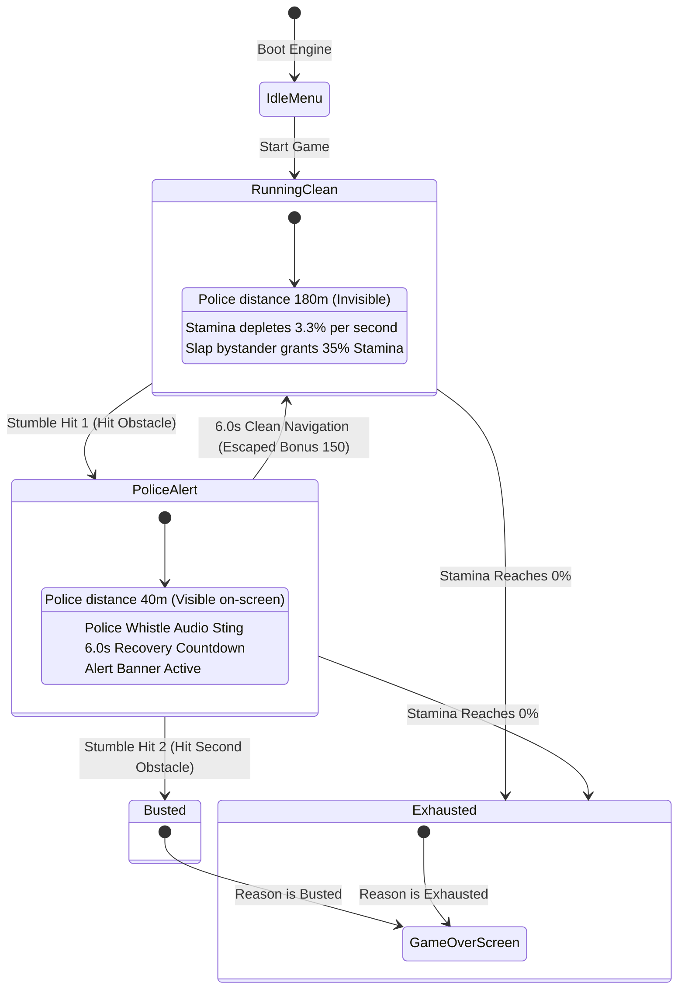

# SlapDash: 2.5D Retro Arcade Boulevard Runner

<div align="center">

```
  ____  _             ____            _     
 / ___|| | __ _ _ __ |  _ \  __ _ ___| |__  
 \___ \| |/ _` | '_ \| | | |/ _` / __| '_ \ 
  ___) | | (_| | |_) | |_| | (_| \__ \ | | |
 |____/|_|\__,_| .__/|____/ \__,_|___/_| |_|
               |_|                          
```

[](LICENSE)
[](https://www.typescriptlang.org/)
[](https://threejs.org/)
[](https://react.dev/)
[](https://vitejs.dev/)
[](https://developer.mozilla.org/en-US/docs/Web/API/Web_Audio_API)
[](https://github.com)
[](https://github.com)

A fast-paced, hilarious 2.5D retro market runner where you slap quirky pedestrians to maintain stamina, navigate a 5-lane dynamic boulevard, dodge dangerous hazards, and outsmart a relentless Subway Surfers-style chasing police officer.

[Play Game Live](#how-to-play) | [Architecture](#system-architecture) | [Testing](#testing-and-quality-assurance) | [Security](#security-and-data-privacy) | [License](#license)

</div>

---

## Table of Contents
1. [What is SlapDash](#what-is-slapdash)
2. [How to Play](#how-to-play)
3. [Controls and Keybindings](#controls-and-keybindings)
4. [The Stamina Mechanic](#the-stamina-mechanic)
5. [Subway Surfers Police Pursuit Two-Hit Rule](#subway-surfers-police-pursuit-two-hit-rule)
6. [Five-Lane Boulevard and Escape Routes](#five-lane-boulevard-and-escape-routes)
7. [Chaos Multiplier and Fever Mode](#chaos-multiplier-and-fever-mode)
8. [Obstacle and Hazard Catalog](#obstacle-and-hazard-catalog)
9. [System Architecture](#system-architecture)
10. [Quick Start and Installation](#quick-start-and-installation)
11. [Testing and Quality Assurance](#testing-and-quality-assurance)
12. [Security and Data Privacy](#security-and-data-privacy)
13. [Code of Conduct](#code-of-conduct)
14. [License](#license)

---

## What is SlapDash

SlapDash is a high-energy retro arcade game engineered with Three.js and React 19. Set on an endless procedural 5-lane Mediterranean market boulevard, players sprint forward at accelerating speeds while dodging obstacles, collecting gold coins, and managing an aggressive crowd.

Slapping is Mandatory: Players cannot simply cruise down the center lane collecting coins. Your runner energy and stamina continuously drains. Every slap landed on a sidewalk bystander restores 35% stamina. If you fail to slap before your gauge empties, your runner collapses from exhaustion.

Subway Surfers Two-Hit Chase Rule: A police officer and angry market pursuers persistently stalk behind you. Navigating cleanly keeps them out of sight. Stumbling into an obstacle brings the officer roaring on-screen. Hitting a second obstacle while they are on-screen results in an instant Busted capture.

Strategic 5-Lane Navigation: Left and right paths feature sidewalk platforms with bystanders to slap, but carry higher hazard density. Center lanes are safer from obstacles but contain no bystanders. Players must actively risk the outer lanes to replenish stamina and duck into open coin-marked escape routes.

Zero External Assets: All 3D voxel models, street architecture, lighting shaders, and audio sound effects are generated procedurally in code via WebGL and the native Web Audio API.

---

## How to Play

### Controls and Keybindings

| Input Method | Steer / Lane Switch | Slap Action | Pause / Resume | Audio Toggle |
| :--- | :--- | :--- | :--- | :--- |
| Desktop Keyboard | A / D or Left / Right Arrow | Spacebar | Escape or P | M |
| Desktop Mouse | Drag left / right on road | Left-Click anywhere | HUD Pause Button | HUD Mute Button |
| Mobile Touch | Virtual On-Screen Joystick | Tactile Emerald SLAP Button | HUD Pause Button | HUD Mute Button |

---

### The Stamina Mechanic

Continuous Drain: Stamina depletes at approximately 3.3% per second (around 30 seconds buffer from 100%).

Replenish Energy: Landing a slap on a sidewalk pedestrian awards 35% stamina (capped at 100%), plays an emerald sound chime, and displays +35 STAMINA.

Low Energy Warning: When stamina drops below 25%, the HUD pulses red and triggers an urgent heartbeat alert: SLAP TO RECHARGE.

Exhaustion Game Over: If stamina reaches 0%, the player collapses from exhaustion, triggering GAME OVER: OUT OF STAMINA.

---

### Subway Surfers Police Pursuit Two-Hit Rule

```
[ CLEAN RUNNING ] ---> (Hit Obstacle 1) ---> [ POLICE ON-SCREEN ] ---> (Hit Obstacle 2) ---> [ BUSTED / GAME OVER ]
        ^                                              |
        +------------ (Run Cleanly for 6.0s) ----------+
```

1. Off-Screen Stealth: While dodging obstacles cleanly, the officer trails 180 units behind camera and is not visible on-screen.
2. First Stumble: Colliding with any obstacle causes the runner to stumble, playing a police whistle and surging the officer directly onto the screen (around 40 units behind the player).
3. Danger Window: An urgent HUD alert triggers: CHASER ON-SCREEN! 1 MORE HIT = BUSTED.
4. Second Stumble: Hitting a second obstacle while the chaser is on-screen results in an immediate tackle and Busted Game Over.
5. Clean Escape: Avoiding all obstacles for 6.0 consecutive seconds shakes off the officer, pushes them back off-screen, and grants an ESCAPED CHASER +150 bonus.

---

### Five-Lane Boulevard and Escape Routes

The track consists of 5 equidistant lanes:

```
  [Platform Left]   Lane -200    Lane -100     Lane 0     Lane 100    Lane 200   [Platform Right]
   (Bystanders)      (Hazard)     (Hazard)    (Escape)    (Hazard)    (Escape)     (Bystanders)
                         |           |           |           |           |
                         v           v           v           v           v
                      Barrier      Crate     Coins Path    Barrel    Coins Path
```

Hazard Balancing: Obstacle waves occupy 2 to 3 lanes maximum, strictly guaranteeing 2 to 3 open escape routes.

Coin Breadcrumbs: Gold coin lines spawn in the open escape routes, guiding players toward safety.

Weighted Risk: Side lanes (-200 and +200) have a 65% higher hazard weight than the center (0), creating high-risk high-reward opportunities when venturing to the platforms to slap pedestrians.

Gradual Acceleration: Running speed starts at a brisk 5.2 base speed and steadily increases as distance grows.

---

### Chaos Multiplier and Fever Mode

Slap Combos: Each slap builds the combo meter and charges the Chaos Gauge.

Multiplier Escalation:
1. 25% Chaos yields 2x Multiplier
2. 50% Chaos yields 4x Multiplier
3. 75% Chaos yields 8x Multiplier
4. 100% Chaos triggers 16x FEVER RUN

Fever Mode: 5.5 seconds of invulnerable turbo sprint. Smash through all obstacles without stumbling, lock stamina at 100%, and earn double points.

---

### Obstacle and Hazard Catalog

| Obstacle | Visual Description | Hazard Behavior | Avoidance Strategy |
| :--- | :--- | :--- | :--- |
| Fruit Crate | Wooden produce crate piled with voxel apples and oranges | Stationary solid block | Swerve into adjacent escape lane or leap over |
| Construction Barrier | Heavy orange and white striped road barrier | Tall barricade spanning a full lane | Cannot leap over; must swerve into open lane |
| Rolling Barrel | Wooden keg with copper bands rolling straight down lane | Dynamic rolling hazard with predictable lane velocity | Dodge laterally before the barrel reaches you |
| Market Pushcart | Merchant wooden pushcart with striped fabric canopy | Wide obstacle with side clearance requirements | Maintain distance and steer into open route |
| Boost Ramp | Sloped wooden ramp with glowing neon directional arrows | Launch trigger: catapults runner into high-altitude air | Run directly into ramp for high leap bonus |

Note: Yellow banana peel hazards have been completely removed for balanced, fair gameplay.

---

## System Architecture

### High-Level Component Flow

```
+------------------------------------------------------------------------+
|                        SlapDash Game Client                            |
+-----------------------------------+------------------------------------+
                                    |
          +-------------------------+------------------------+
          v                         v                        v
+-------------------+     +-------------------+     +-------------------+
|   Touch / Keys    |     |   Game Engine     |     |  Procedural Web   |
|   Input Buffer    |---->|   State Machine   |<--->|  Audio Synth      |
|  (Joystick, A/D,  |     |  (Stamina, Speed, |     | (BPM, Whistle,    |
|   Space, Haptics) |     |   Mob AI, Wave)   |     |  Chimes, Slaps)   |
+-------------------+     +---------+---------+     +-------------------+
                                    |
          +-------------------------+------------------------+
          v                         v                        v
+-------------------+     +-------------------+     +-------------------+
|  Three.js WebGL   |     |  React 19 UI /    |     |  Full-Stack       |
|  3D Renderer      |     |  HUD Layer        |     |  Express API      |
| (Voxel Pipeline,  |     |  (Stamina Gauge,  |     |  (Leaderboard,    |
|  Shadows, Shakes) |     |   Police Alert)   |     |   Rank Check)     |
+-------------------+     +-------------------+     +-------------------+
```

### Two-Hit Police Chase State Machine



---

## Quick Start and Installation

### Prerequisites
1. Node.js version 18.0.0 or higher
2. npm version 9.0.0 or higher
3. Modern WebGL2-compatible browser (Chrome, Edge, Safari, Firefox)

### Installation Steps

1. Clone the repository:
   ```bash
   git clone https://github.com/thesithunyein/ss.git
   cd ss
   ```

2. Install dependencies:
   ```bash
   npm install
   ```

3. Launch development server:
   ```bash
   npm run dev
   ```
   Open http://localhost:3000 in your browser.

4. Build for production:
   ```bash
   npm run build
   ```

5. Run full-stack production server:
   ```bash
   npm start
   ```

---

## Testing and Quality Assurance

### Automated Lint and Type Verification
```bash
npm run lint
```

### Production Build Validation
```bash
npm run build
```

### Manual QA and Viewport Test Matrix

| Viewport Profile | Target Device | Verified Features |
| :--- | :--- | :--- |
| 360 x 640 (9:16) | Standard Android Handset | Touch joystick, haptic vibrations, stamina gauge layout |
| 390 x 844 (19.5:9) | Apple iPhone | Safe-area notch padding, crisp pixel typography, 60 FPS WebGL |
| 768 x 1024 (3:4) | Apple iPad / Tablet | Scaled UI containers, responsive field-of-view, low touch latency |
| 1920 x 1080 (16:9) | Desktop PC / Laptop | Keyboard arrow and WASD steering, mouse tracking, spacebar slap response |

---

## Security and Data Privacy

### Security Posture

Zero Third-Party Telemetry: SlapDash does not load external analytics, user trackers, tracking pixels, or ad networks.

Client-Side Data Isolation: Player preferences, high scores, collected coins, and unlocked skins are stored solely within standard browser localStorage.

API Defense and Sanitization:
1. Leaderboard submission endpoint POST /api/leaderboard validates and bounds all payloads.
2. Runner names are sanitized, trimmed, and capped at 16 characters to prevent XSS.
3. Scores are validated as positive non-zero integers on the server before registration.

Audio Privacy: Web Audio contexts are initialized strictly on explicit user gesture (click or tap) in compliance with browser autoplay security policies.

---

## Code of Conduct

### Our Standard
We are committed to providing a welcoming, inspiring, and harassment-free environment for everyone participating in our gaming community and tournament leaderboards.

### Community Guidelines
1. Fair Play: Automated macro bots, artificial memory manipulation, or submission spoofing on the global leaderboard is prohibited.
2. Respectful Usernames: Player names submitted for share cards and tournament leaderboards must remain civil, free of offensive language, hate speech, or harassment.
3. Constructive Collaboration: When suggesting features, reporting bugs, or contributing code, please communicate with kindness and respect.

---

## License

Distributed under the MIT License. See LICENSE for more information.

Copyright (c) 2026 Sithu Nyein and Digit7 Jam Contributors

Permission is hereby granted, free of charge, to any person obtaining a copy
of this software and associated documentation files (the "Software"), to deal
in the Software without restriction, including without limitation the rights
to use, copy, modify, merge, publish, distribute, sublicense, and/or sell
copies of the Software, and to permit persons to whom the Software is
furnished to do so, subject to the following conditions:

The above copyright notice and this permission notice shall be included in all
copies or substantial portions of the Software.

THE SOFTWARE IS PROVIDED "AS IS", WITHOUT WARRANTY OF ANY KIND, EXPRESS OR
IMPLIED, INCLUDING BUT NOT LIMITED TO THE WARRANTIES OF MERCHANTABILITY,
FITNESS FOR A PARTICULAR PURPOSE AND NONINFRINGEMENT. IN NO EVENT SHALL THE
AUTHORS OR COPYRIGHT HOLDERS BE LIABLE FOR ANY CLAIM, DAMAGES OR OTHER
LIABILITY, WHETHER IN AN ACTION OF CONTRACT, TORT OR OTHERWISE, ARISING FROM,
OUT OF OR IN CONNECTION WITH THE SOFTWARE OR THE USE OR OTHER DEALINGS IN THE
SOFTWARE.

<div align="center">
  Built by Sithu Nyein for Digit7 Jam. Running at 60 FPS on WebGL and React 19.
</div>
