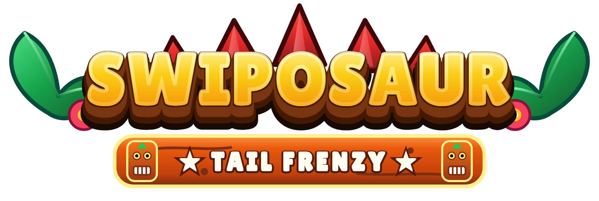
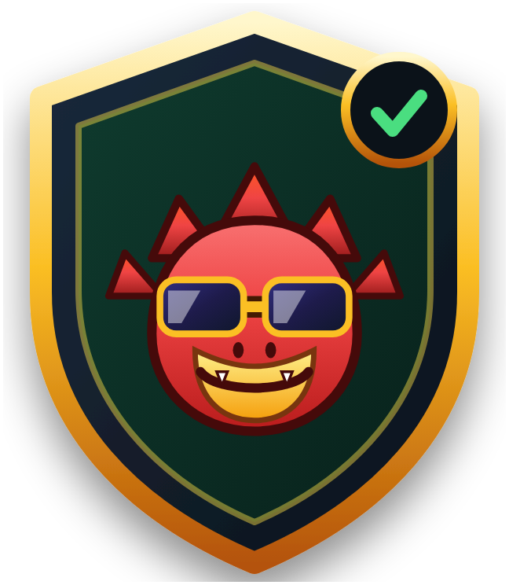
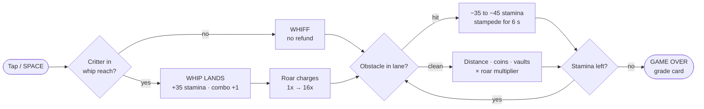
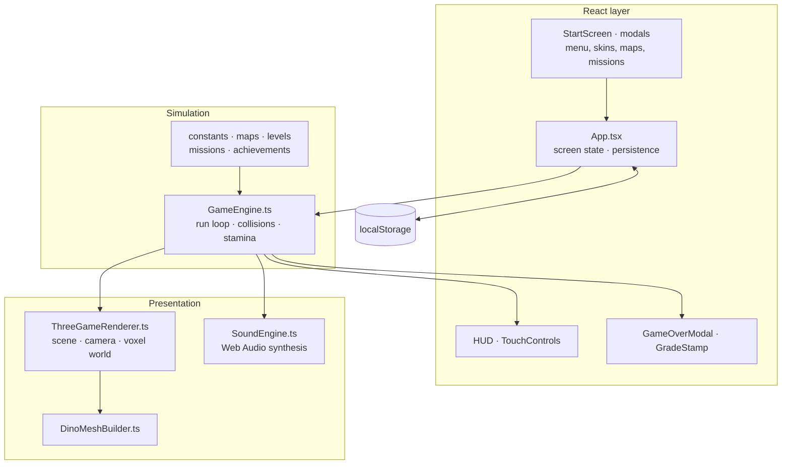

 

### Digit7 Jam 2026 · HTML arcade game · v1.0.0

**Team:** Sithu Nyein (individual participant)

## 1. Game title

**Swiposaur: Tail Frenzy**

## 2. Team name

Sithu Nyein (individual participant)

## 3. Main contact person

Sithu Nyein, sithunyein.mailto@gmail.com, Telegram: @sithunyein

## 4. Short game description

Swiposaur is a 3D voxel arcade runner. You play a party-sunglasses dinosaur sprinting
through prehistoric streets: change lanes, jump barriers, slide under obstacles and
**tail-whip** pedestrians to refill stamina and charge the Primal Roar. One mistake brings
the stampede onto your heels; three mistakes end the run. Skins, biomes, daily missions
and a local Hall of Fame keep runs coming.

## 5. How to open and play

1. Open the playable URL on the Digit7 hosting environment (or any HTTPS static host).
2. No install, login or download is required. The game starts on the title screen.
3. Press **PLAY**. The opening cinematic asks for one tail-whip (tap / `Space`).
4. After the intro you get a **6-second safe start** before the stampede begins.
5. Survive as long as possible, whip critters to refill stamina, and chase a higher grade.

Local build: `npm install && npm run build`, then serve `dist/` (or `npm run preview`).

## 6. Supported browsers

Chrome, Edge, Firefox and Safari, current stable. Verified: Chrome, desktop and mobile
viewports (360×640, 390×844, 1280×720). Firefox and Safari are supported targets but were
not verified on physical devices before submission. WebGL required.

## 7. Supported devices

Android 10+, iOS 16+, Windows 10/11, recent macOS. Also works in mobile WebViews.
Best on a phone in portrait (360×640 and up) or any desktop window (1280×720 and up).

## 8. Controls and gameplay

- **Lane change:** `A`/`D` or `←`/`→`; swipe left/right on touch.
- **Jump:** `W`, `↑`, `Space` when not beside a critter; swipe up.
- **Slide:** `S`, `↓`; swipe down.
- **Tail-whip:** `Space`, `F`, `Enter`, whip button, or tap the screen.
- **Pause:** `P` / `Esc` or the pause button.

Scoring: distance + coins + vaults + near-misses + whip combos, multiplied by the Roar
meter (1×–16×). Stamina refills only on a landed whip.

Grades are read off the run itself, not the multiplier: **C** below 3,000 points · **B**
3,000 · **A** 7,000 · **S** 14,000 (or 800 m with an 8× combo) · **S+** 24,000 (or
1,100 m with a 12× combo).

### How it works

## 9. Known bugs and limitations

- No offline mode: there is **no service worker**, so there is no install prompt and no
  cached play. "Add to Home Screen" only creates a shortcut.
- The Hall of Fame is stored locally on the device; the optional online ledger is disabled
  by default (no server is required for the game to run).
- Fonts load from Google Fonts; with the network blocked the UI falls back to system fonts.
- Very low-end GPUs may dip below 30 FPS at high device pixel ratios.

## 10. Third-party tools and libraries

React 19, React DOM, Three.js r186, Vite 8, Tailwind CSS 4, TypeScript, lucide-react,
Express (optional dev server only). No game engine, template or paid asset pack is used.

### Architecture

## 11. Asset credit summary

- All art, 3D models, textures, logo and icons: original, generated in code (Three.js
  primitives + inline SVG), Apache-2.0.
- All music and SFX: original, synthesized at runtime with the Web Audio API. No audio files.
- Fonts: Fredoka, Lilita One, Titan One, Sniglet, Press Start 2P (Google Fonts, SIL OFL 1.1).
- Code libraries: MIT / ISC / Apache-2.0, see `README.md` for the full table.
- No third-party art, sprites, music or purchased assets are included.

## 12. Special testing instructions

- Test both a desktop browser and a phone; touch controls are swipe + a 72 px whip button.
- If a run feels too easy or too hard, note the grade and distance on the game-over card.
- To reset progress: Settings (gear icon, top right of the menu) → Reset progress, or
  clear site data.
- Quick smoke test: PLAY → whip the intro rival → survive 6 s → whip a sidewalk critter
  (stamina +35) → pause → resume → finish the run and check the grade card.

## 13. Recommended orientation, resolution, aspect ratio

Portrait on phones (about 9:19.5, minimum 360×640). Desktop: any orientation, 1280×720 or
larger. The canvas fills the viewport and letterboxes nothing.

## 14. Network, API and third-party services

- **Required network:** none. The game is fully client-side.
- **Optional:** `VITE_LEADERBOARD_API=true` enables `/api/leaderboard`; `VITE_ANALYTICS_URL`
  enables telemetry. Both are **off** in the submitted build.
- **External requests in the submitted build:** Google Fonts stylesheet only.
- **Storage:** `localStorage` for scores, coins, skins, settings, missions and achievements.
- No accounts, cookies, ads, trackers, crypto, downloads or device permissions.

## 15. AI tools used and purpose

- **Google AI Studio (Gemini):** initial scaffolding, component drafts, UI copy.
- **An AI coding assistant:** refactors, gameplay tuning, documentation and review.

Affected areas: most of `src/` was AI-assisted and then reviewed, tested and edited by the
developer. No AI-generated images, audio or fonts are shipped: all visuals are code-drawn
and all sound is synthesized. The developer has read and can explain every file and is
responsible for the submitted code.

## 16. Repository and build access

- Repository: https://github.com/thesithunyein/swiposaur
- Submission commit/tag: `v1.0.0`
- Build: `npm install && npm run build` → `dist/`
- The repository is public, so reviewers can open it without an invitation. If the
  organizer requires a private repository, access will be granted to the announced
  reviewer account before the deadline.

## 17. Build version

**v1.0.0**: Digit7 Jam 2026 submission build. The playable URL, the ZIP and this
repository all point at this tag.
